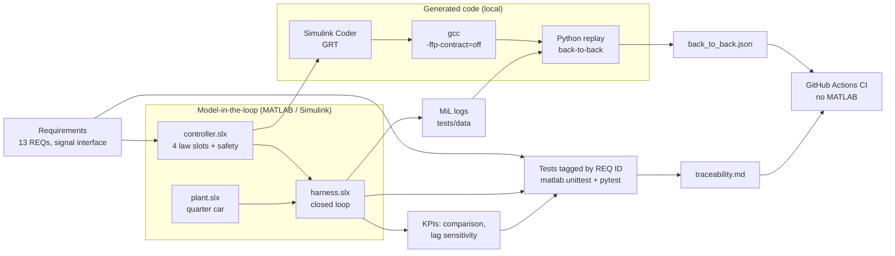
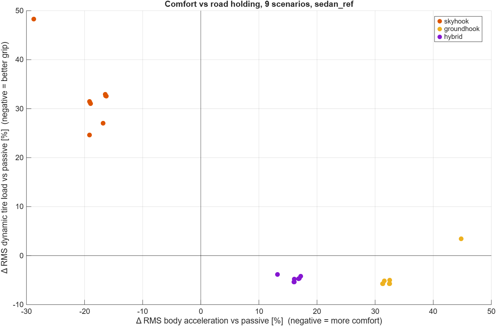
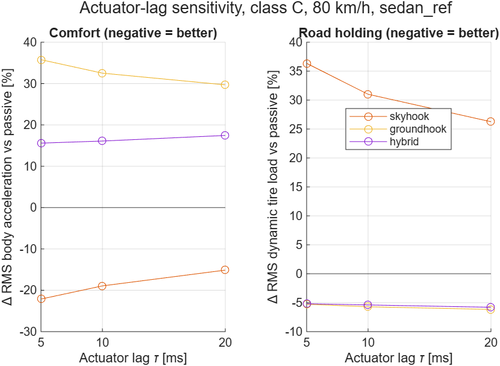

# Semi-Active Damper Function


Requirements-driven development of a semi-active suspension damper controller,
from written requirements through Simulink model-in-the-loop (MiL) verification
to generated C code that is checked sample by sample against the model.

<!-- Demo GIF (M6 task 5): uncomment when docs/demo.gif exists

-->

## Problem

A passive damper fixes one compromise between ride comfort and road holding.
A semi-active damper can change its damping every millisecond but can only take
energy out of the motion, so the control strategy has to work within that limit,
safely, and in code that behaves exactly like the model it was designed in.

## Architecture



Left side of the V-model: requirements and interface first (M1), with every
threshold marked as a project assumption before any result existed. Then the
plant and passive baseline (M2), the controller with four strategies in one
model (M3), requirement-based tests with a generated traceability report (M4),
and generated C code verified back-to-back against the MiL logs (M5).

## Results

### Measured

Passive versus the three control strategies, reference vehicle (mid-size sedan),
change versus passive on the same road; **negative = better**.

<!-- BEGIN generated:comparison (src/python/readme_results.py; do not edit by hand) -->
**Random road, class C, 80 km/h (SC-C80)**

| Strategy | RMS body acc. [m/s²] | Δ comfort | RMS dyn. tire load [N] | Δ road holding | Max travel [mm] | Δ travel |
|---|---|---|---|---|---|---|
| Passive | 1.51 | – | 669 | – | 35.9 | – |
| Skyhook | 1.22 | −18.9 % | 876 | +31.0 % | 40.5 | +12.9 % |
| Groundhook | 2.00 | +32.5 % | 630 | −5.7 % | 35.9 | +0.0 % |
| Hybrid (α = 0.5) | 1.75 | +16.1 % | 632 | −5.4 % | 26.0 | −27.4 % |

**Bump 50 mm × 0.5 m at 18 km/h (SC-BUMP)**

| Strategy | RMS body acc. [m/s²] | Δ comfort | RMS dyn. tire load [N] | Δ road holding | Max travel [mm] | Δ travel |
|---|---|---|---|---|---|---|
| Passive | 1.22 | – | 448 | – | 53.3 | – |
| Skyhook | 0.87 | −28.8 % | 664 | +48.3 % | 66.3 | +24.4 % |
| Groundhook | 1.76 | +44.8 % | 463 | +3.5 % | 38.4 | −28.0 % |
| Hybrid (α = 0.5) | 1.38 | +13.2 % | 431 | −3.8 % | 48.0 | −9.9 % |

<sub>Source: [`results/comparison/kpi_comparison_sedan_ref.csv`](results/comparison/kpi_comparison_sedan_ref.csv)</sub>
<!-- END generated:comparison -->



Verification:

<!-- BEGIN generated:verification (src/python/readme_results.py; do not edit by hand) -->
| Check | Result |
|---|---|
| Requirements (13) | **12 Pass, 1 Fail (1 known), 0 Unverified** (commit `b86baac`) |
| Fault reaction, REQ-S-01 (limit 10 ms) | **5 ms** |
| Generated C code vs MiL, REQ-V-01 | **max \|Δ i_cmd\| = 0 A** over 26,003 samples (SC-BUMP, SC-C80, SC-FAULT); fault_active identical: yes |

<sub>Source: [`results/traceability.md`](results/traceability.md)</sub> · <sub>Source: [`results/back_to_back.json`](results/back_to_back.json)</sub>
<!-- END generated:verification -->

Actuator-lag sensitivity: the damper valve follows the current command with a
first-order lag τ (nominal 10 ms). Change versus passive at the same lag, SC-C80:

<!-- BEGIN generated:lag (src/python/readme_results.py; do not edit by hand) -->
| Actuator lag τ | Skyhook Δ comfort | Skyhook Δ road holding | Groundhook Δ comfort | Groundhook Δ road holding | Hybrid Δ comfort | Hybrid Δ road holding |
|---|---|---|---|---|---|---|
| 5 ms | −22.1 % | +36.4 % | +35.8 % | −5.3 % | +15.6 % | −5.2 % |
| 10 ms (nominal) | −18.9 % | +31.0 % | +32.5 % | −5.7 % | +16.1 % | −5.4 % |
| 20 ms | −15.1 % | +26.3 % | +29.7 % | −6.2 % | +17.5 % | −5.8 % |

<sub>Source: [`results/sensitivity/lag_sensitivity_sedan_ref.csv`](results/sensitivity/lag_sensitivity_sedan_ref.csv)</sub>
<!-- END generated:lag -->



### Assumptions

- **Vehicle:** quarter car of a mid-size sedan with the IRI Golden Car ratios and
  m<sub>s</sub> = 230 kg (D14); three further vehicles are scaled variants (D16).
- **Roads:** ISO 8608-based random profiles (classes A–D) and a half-sine bump,
  generated with a fixed seed so every strategy sees the same road.
- **Sensors and faults:** ideal body and wheel velocities (no estimator, D5);
  fault detection is an external flag, only the reaction is verified (D6).
- **Actuator:** linear damper map 0.3–1.6 A ↔ c<sub>min</sub>–c<sub>max</sub>,
  first-order lag 10 ms (varied in the sensitivity study).
- **Thresholds:** every requirement threshold is a *proposed project assumption*
  with its rationale and literature check in
  [requirements/REQ.md](requirements/REQ.md) (D11).
- **Control-law parameters:** c<sub>sky</sub> = c<sub>gnd</sub> = c<sub>max</sub>,
  α = 0.5 (D25); not tuned.

### Interpretation

*By the author.* Skyhook gives clearly better comfort than passive but loses
road holding: the dynamic tire load rises by about a third, which fails
REQ-P-02. This is reported, not hidden: the strategy needs further development
to bound its road-holding penalty, and the threshold stays. Groundhook does the
opposite, and the hybrid law lies between them with much less suspension travel
but less comfort than passive (its parts never let it go soft with the chosen
parameters).

The actuator lag matters most for skyhook, which switches often between soft
and firm: the slower the valve, the smaller both its comfort gain and its
road-holding penalty. Within the studied range skyhook still meets the comfort
requirement. Groundhook's comfort loss also shrinks with a slower valve; the
hybrid law changes least.

## Traceability

Every requirement is linked to its tests by ID; the report with tests,
acceptance criteria and measured values is generated by `run_tests()`:
[results/traceability.md](results/traceability.md).

<!-- BEGIN generated:traceability (src/python/readme_results.py; do not edit by hand) -->
| Requirement | Title | Verdict |
|---|---|---|
| REQ-F-01 | Current limits | **Pass** |
| REQ-F-02 | Sample time | **Pass** |
| REQ-F-03 | Initialization | **Pass** |
| REQ-F-04 | Rate limit | **Pass** |
| REQ-F-05 | Finite output | **Pass** |
| REQ-P-01 | Ride comfort | **Pass** |
| REQ-P-02 | Road holding penalty | **Fail (known)** |
| REQ-P-03 | Suspension travel | **Pass** |
| REQ-P-04 | Robustness across vehicles | **Pass** |
| REQ-S-01 | Fault reaction | **Pass** |
| REQ-S-02 | Fault latch | **Pass** |
| REQ-V-01 | Generated code matches model | **Pass** |
| REQ-V-02 | Reference data provenance | **Pass** |

<sub>Source: [`results/traceability.md`](results/traceability.md)</sub>
<!-- END generated:traceability -->

## Run it

### Without MATLAB (what CI runs)

Python 3.11, in a virtual environment named `.venv` in the repository folder
(`run_tests()` in MATLAB uses exactly this one):

```bash
py -3.11 -m venv .venv            # Linux/macOS: python3.11 -m venv .venv
.venv\Scripts\activate            # Linux/macOS: source .venv/bin/activate
pip install -r requirements.txt
pytest -q tests/python
```

On Windows use the `py -3.11` launcher: a plain `python` may start another
installation (other tools often bring their own Python). All tests pass; the
six back-to-back tests that need the locally generated code are skipped with the
reason shown by `pytest -rs`.

### With MATLAB

Requirements: MATLAB R2026a with Simulink and Simulink Coder; the Add-On
*MATLAB Support for MinGW-w64 C/C++ Compiler*; the Python environment above.

| Step | Command (MATLAB) | Result |
|---|---|---|
| 1 | `openProject('<repo folder>')` | path set (the scripts also open it themselves) |
| 2 | `generate_controller_code()` | C code in `src/generated/controller/` (local; needs a clean git tree) |
| 3 | `R = run_tests()` | all MATLAB and Python tests, back-to-back record, `results/traceability.md` |
| 4 | `run_comparison()`, `run_lag_sensitivity()` | regenerate the committed results |
| 5 | edit and run `my_study` | your own roads × strategies in `results/studies/` |

Without step 2, `run_tests()` still runs everything else and reports REQ-V-01
as *Unverified*.

## What is verified where

| Verified | Local (MATLAB) | CI (no MATLAB) |
|---|---|---|
| Plant, roads, KPIs, controller laws, safety logic (unit and model tests) | ✓ | – |
| Closed loop against an independent plain-MATLAB reference | ✓ | – |
| Requirement verdicts and traceability report | ✓ | – |
| Generated C code bit-identical to MiL (REQ-V-01) | ✓ replay | ✓ committed record matches model, parameters and logs |
| MiL log provenance (REQ-V-02) | ✓ | ✓ |
| README results equal the committed result files | ✓ | ✓ |

The generated C code carries the MathWorks **academic license** banner, so it is
**not committed** and not covered by this repository's MIT license; it is
generated, built and replayed locally, and only the result is committed
([src/generated/README.md](src/generated/README.md), decisions D10 rev. and D28).

## Limitations

This project does **not** demonstrate:

- **State estimation:** the controller gets ideal velocities; a real system
  needs an estimator from accelerometers.
- **Advanced control:** only skyhook, groundhook and their blend; no MPC.
- **Real time and hardware:** no real-time execution, no PiL/HiL, no target
  hardware; the back-to-back replays logged inputs open loop.
- **Vehicle validation:** a linear quarter car with tire lift-off, not a
  validated vehicle model; three of four vehicles are scaled variants.
- **Functional safety:** no ISO 26262 process or certification; fault
  detection is outside the scope.
- **Road holding:** REQ-P-02 fails for skyhook (known, reported).

## Next steps

The plan after v1.0, each as a new version: **v2** a full-state controller
interface for the quarter car with classical model predictive control (MPC) as
the main goal, followed by further strategies; **v3** a half car; **v4** a full
vehicle, each adapting the whole workflow of this project.

## Repository

| Path | Content |
|---|---|
| [requirements/](requirements/) | requirements REQ-F/P/S/V with acceptance criteria |
| [interface/](interface/) | controller signal interface |
| [model/](model/) | `plant.slx`, `controller.slx`, `harness.slx` |
| [src/matlab/](src/matlab/) | simulation, study and test scripts |
| [src/python/](src/python/) | build, back-to-back replay, README results |
| [tests/](tests/) | MATLAB and Python tests, MiL reference logs |
| [results/](results/) | committed results (all script-generated) |
| [docs/](docs/) | decisions, MiL-to-SiL rules, CI notes, development log |

Toolchain: MATLAB R2026a · Simulink · Simulink Coder (GRT, no Embedded Coder) ·
Python 3.11 · gcc. History of every change: [CHANGELOG.md](CHANGELOG.md).

## License

[MIT](LICENSE), except the locally generated C code (see above).
